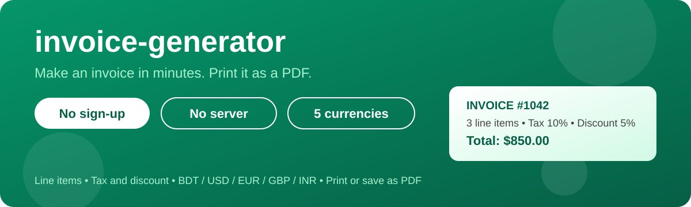
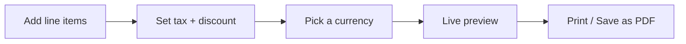

<p align="center">
  
</p>

<p align="center">
  <a href="https://smabdulmueid97.github.io/invoice-generator/"></a>
  <a href="https://github.com/smabdulmueid97/invoice-generator"></a>
  <a href="https://github.com/smabdulmueid97/invoice-generator/stargazers"></a>
</p>

<h1 align="center">invoice-generator</h1>

<p align="center">
  A simple invoice generator — <b>no sign-up, no server</b>. Everything runs in your browser.<br />
  Add line items, set tax and discount, pick a currency, and <b>print / save as PDF</b>.
</p>

<p align="center">
  <a href="https://smabdulmueid97.github.io/invoice-generator/">🔗 Live demo</a> •
  <a href="#-what-it-does">Features</a> •
  <a href="#-use-it">Use it</a> •
  <a href="#-layout">Layout</a>
</p>

---

## ✨ What it does

| Feature | Detail |
|---|---|
| Line items | Add / remove items — quantity × price auto-calculates |
| Tax & discount | Tax % and discount % applied to the total |
| Currencies | BDT ৳, USD $, EUR €, GBP £, INR ₹ |
| Invoice details | Invoice number, invoice date & due date |
| Preview | Live preview as you type |
| Export | Print / Save as PDF (browser print), or download as HTML |
| Reset | Clear the form and start over |



## 🚀 Use it

Open the live demo, or open `index.html` in a browser — no build step, no install.

**[https://smabdulmueid97.github.io/invoice-generator/](https://smabdulmueid97.github.io/invoice-generator/)**

1. Fill in the invoice number, dates, and client details.
2. Add line items — totals update automatically.
3. Set tax % and discount % if you need them.
4. Print / Save as PDF, or download the invoice as HTML.

Nothing leaves your browser — there is no server and no account.

## 🗂️ Layout

```
index.html      # page structure
styles.css      # styling + print styles
app.js          # invoice logic
README.md       # this file
```

## License

This project is licensed under the MIT License — see the LICENSE file.
