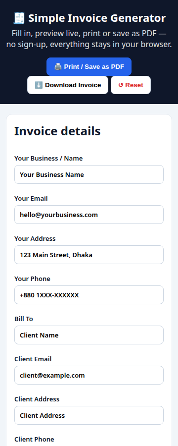
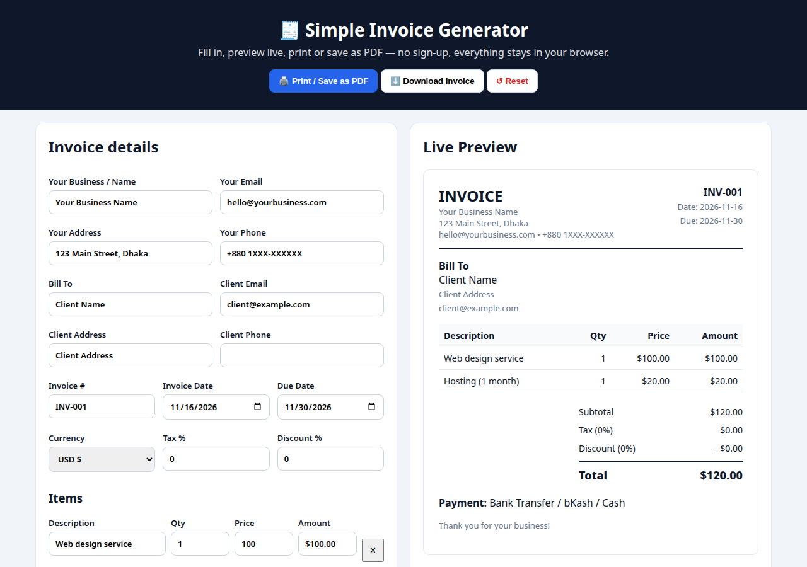

# Invoice Generator

**A free invoice generator. No sign-up, no server.**

Everything runs in your browser. Add line items, set tax and discount, pick a currency, print to PDF — done.

**[▶ Try it in 10 seconds — live demo](https://smabdulmueid97.github.io/invoice-generator/)**

No account. No data leaves your browser.

---

## Screenshots

| Mobile | Desktop |
|---|---|
|  |  |

> Tested at 360 / 768 / 1280 px — no horizontal overflow, no clipped buttons.

---

## Features

- Add / remove line items — quantity & price auto-calculate
- Tax % and discount %
- Currency: BDT ৳, USD $, EUR €, GBP £, INR ₹
- Invoice number, invoice date & due date
- Live preview
- Print / Save as PDF (browser print)
- Download invoice as HTML
- Reset form

## Use

Open `index.html` in a browser, or visit the [live demo](https://smabdulmueid97.github.io/invoice-generator/).

## Files

- `index.html` — page structure
- `styles.css` — styling + print styles
- `app.js` — invoice logic

## Related repos

- [freelancer-skills](https://github.com/smabdulmueid97/freelancer-skills) — the full money workflow as Claude Code skills: invoice, quote, expenses, payment follow-ups, monthly summary

## License

MIT
